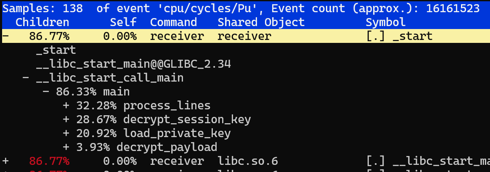
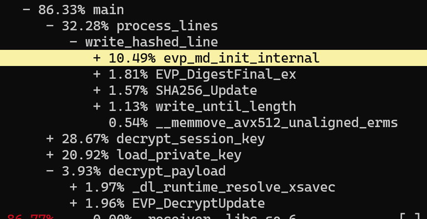
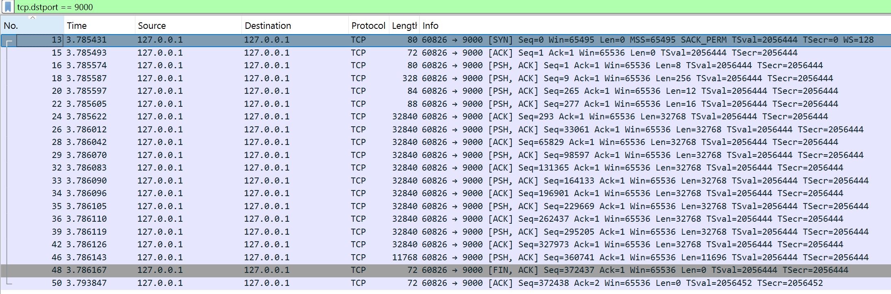

## ビルド
```sh
make all
make keys
```

## 受信側
```sh
./receiver output.txt
```

## 送信側
```sh
./sender input.txt # 正常の入力
./sender bad-input.txt # segfaultを起こす入力
```

## デバッグツールとの実行

### valgrind

```
==65735== Command: ./receiver output.txt
==65735==
Listening on :9000...
Wrote to output.txt
==65735==
==65735== HEAP SUMMARY:
==65735==     in use at exit: 808,731 bytes in 6,668 blocks
==65735==   total heap usage: 10,895 allocs, 4,227 frees, 1,862,653 bytes allocated
==65735==
==65735== LEAK SUMMARY:
==65735==    definitely lost: 411,144 bytes in 600 blocks
==65735==    indirectly lost: 0 bytes in 0 blocks
==65735==      possibly lost: 0 bytes in 0 blocks
==65735==    still reachable: 397,587 bytes in 6,068 blocks
==65735==         suppressed: 0 bytes in 0 blocks
==65735== Rerun with --leak-check=full to see details of leaked memory
==65735==
==65735== For lists of detected and suppressed errors, rerun with: -s
==65735== ERROR SUMMARY: 0 errors from 0 contexts (suppressed: 0 from 0)
```

行を書き出すたびにデータを確保するが解放していないせいで、600行の入力で`600 blocks`が`definitely lost`となる。

### strace

```
openat(AT_FDCWD, "output.txt", O_WRONLY|O_CREAT|O_TRUNC, 0644) = 6
write(6, "7E4DA2BC86CA1AB0E28934CA71226924"..., 859) = 859
write(6, "81E082AC4E0BDA9FEDDF69DD2A09FD0D"..., 646) = 646
write(6, "13311588110E5512FF8BAA619AC214E5"..., 718) = 718
write(6, "DC9E4D878E8EDF2FA50EECC8751BA228"..., 987) = 987
write(6, "E10491944B8E8FC82BB00669E8B3A797"..., 956) = 956
write(6, "FF08CF038C143C9DD7C294FCE204B530"..., 663) = 663
write(6, "55C875E1EA2A62D78438C7D0A411E622"..., 604) = 604
```

書き出し先のファイルを開くときに返されたファイルディスクリプタが 6 であり、
一行一行そのFDに対して書き出しを行うことを確認できる。

### perf

`perf record -F 9999 -g --call-graph dwarf` で計測。



perf により、一番時間がかかったのは `process_lines` という書き出し処理。次に時間がかかるのは共有鍵の複合化、秘密鍵の読み込み、メッセージ複合化。



さらに深堀すると、ハッシュ処理の初期化が結構時間かかったこともわかる。

### wireshark

`tcp.dstport == 9000` でフィルターをかける。



最初の`SYN/ACK`ハンドシェイクの後、`sender`からヘッダー → 共有鍵 → nonce → タッグ → 暗号メッセージの順でデータが送られてくる。
どれがどれかを識別するには `Len` を見てください。8 がヘッダー (4バイトの長さ情報×2)、256が鍵、12がnonce、16がタッグ、そして残りは実際のメッセージとなる。

### gdb

`./sender bad-input.txt` でsegfaultを意図的に起こすと、

```
Listening on :9000...

Program received signal SIGSEGV, Segmentation fault.
0x0000000000400dfb in write_hashed_line (output_fd=6,
    line=0x47e5da "\n\nCurabitur quis sem posuere, dignissim nunc quis, finibus felis. Cras sit amet blandit eros. Ut et ullamcorper quam, sed scelerisque velit. Duis id risus diam. Integer ultrices ipsum lectus, in inter"...,
    line_length=0) at receiver.c:172
172             *record = '\0';
```
receiver.c 172行目のぬるぽアクセスが悪いだということがわかる。
